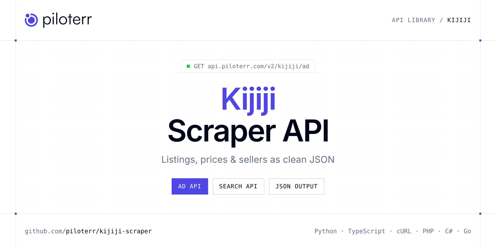

<p align="center">
  <a href="https://www.piloterr.com"></a>
</p>

# Kijiji Scraper API

[](https://discord.gg/CFj3ph8aHU) [](https://app.piloterr.com) [](https://app.piloterr.com/openapi) [](LICENSE)

The **Piloterr Kijiji Scraper API** lets you extract public data from Kijiji as **clean, structured JSON** — no proxies, headless browsers or HTML parsing to maintain. Endpoints available in production:

- **Kijiji Ad API** — Read one Kijiji ad from its id or URL.
- **Kijiji Search API** — Search Kijiji with a results URL or a city and category.

Use it for listing monitoring, price benchmarks, stock sourcing or market analytics on second-hand and vehicle marketplaces.

| Endpoint | Path | Credits | What you get |
|---|---|---|---|
| [Kijiji Ad API](#kijiji-ad-api) | `/v2/kijiji/ad` | 1 | Read one Kijiji ad from its id or URL. You get the asking price, the title, and the city. |
| [Kijiji Search API](#kijiji-search-api) | `/v2/kijiji/search` | 1 | Search Kijiji with a results URL or a city and category. Language can be English or French. Page through classified ads. |

## Table of contents

- [How it works](#how-it-works)
- [Kijiji Ad API](#kijiji-ad-api)
- [Kijiji Search API](#kijiji-search-api)
- [Code examples in other languages](#code-examples-in-other-languages)
- [Practical use cases](#practical-use-cases)
- [Why Piloterr?](#why-piloterr)
- [FAQ](#faq)
- [Related scrapers](#related-scrapers)
- [Support](#support)

## How it works

1. **Create a free Piloterr account** and copy your API key from the [dashboard](https://app.piloterr.com).
2. **Send a `GET` (or `POST`) request** to `https://api.piloterr.com/v2/...` with the header `x-api-key: YOUR_API_KEY`.
3. **Receive structured JSON** — Piloterr handles rendering, proxies, retries and parsing.

```bash
export PILOTERR_API_KEY="your-api-key"
pip install requests        # Python
# TypeScript: Node.js 18+ (native fetch), run with `npx tsx file.ts`
```

> Every endpoint accepts both `GET` (query string) and `POST` (JSON body with the same fields).

## Kijiji Ad API

Read one Kijiji ad from its id or URL. You get the asking price, the title, and the city.

`GET | POST https://api.piloterr.com/v2/kijiji/ad` · **1 credit per request** · [Full reference](https://app.piloterr.com/openapi)

### Request parameters

| Parameter | Type | Required | Description |
|---|---|---|---|
| `query` | string | ✅ | Full Kijiji listing URL or the numeric listing id. |
| `language` | string | — | Locale sent to Kijiji as the siteLocale cookie. `en` sets en-CA and prints `$20`. `fr` sets fr-CA and prints `20 $` on the same ad. |

### Python example

```python
import json
import os
import requests

response = requests.get(
    "https://api.piloterr.com/v2/kijiji/ad",
    headers={"x-api-key": os.environ["PILOTERR_API_KEY"]},
    params={
        "query": "https://www.kijiji.ca/v-cell-phone-accessories/city-of-toronto/nateroso-iphone-16-case-cute-bear-honey-design/1745477275",
    },
    timeout=60,
)
response.raise_for_status()
data = response.json()

print(json.dumps(data, indent=2, ensure_ascii=False)[:2000])
```

### TypeScript example

```typescript
type KijijiAd = {
  id?: string;
  url?: string;
  price?: number;
  title?: string;
  views?: number;
  images?: string[];
  address?: string;
  currency?: string;
  latitude?: number;
  location?: string;
  condition?: string;
  longitude?: number;
  posted_at?: string;
  seller_id?: string;
  attributes?: {
    name?: string;
    value?: string;
  }[];
  description?: string;
  price_display?: string;
};

const params = new URLSearchParams({
  "query": "https://www.kijiji.ca/v-cell-phone-accessories/city-of-toronto/nateroso-iphone-16-case-cute-bear-honey-design/1745477275",
});

const response = await fetch(`https://api.piloterr.com/v2/kijiji/ad?${params}`, {
  headers: { "x-api-key": process.env.PILOTERR_API_KEY! },
});
if (!response.ok) throw new Error(`Piloterr error ${response.status}: ${await response.text()}`);

const data = (await response.json()) as KijijiAd;

console.log(JSON.stringify(data, null, 2).slice(0, 2000));
```

<details>
<summary><b>POST variant</b></summary>

```http
POST https://api.piloterr.com/v2/kijiji/ad
x-api-key: YOUR_API_KEY
Content-Type: application/json

{"query": "https://www.kijiji.ca/v-cell-phone-accessories/city-of-toronto/nateroso-iphone-16-case-cute-bear-honey-design/1745477275"}
```
</details>

### Output example

Example response from the API reference, abridged — real values depend on the page you scrape.

```json
{
  "id": "1745477275",
  "url": "https://www.kijiji.ca/v-cell-phone-accessories/city-of-toronto/nateroso-iphone-16-case-cute-bear-&-honey-design/1745477275",
  "price": 20,
  "title": "NATEROSO iPhone 16 Case – Cute Bear & Honey Design",
  "views": 12,
  "images": [
    "https://media.kijiji.ca/api/v1/ca-prod-fsbo-ads/images/3f/3f481470-f0df-4464-838b-da8b2a1f026e?rule=kijijica-640-webp",
    "https://media.kijiji.ca/api/v1/ca-prod-fsbo-ads/images/15/15193d1f-e4d7-43da-8c1a-a2b94a37e06b?rule=kijijica-640-webp"
  ],
  "address": "Canadian Rd, Scarborough, ON M1R 4Z5",
  "currency": "CAD",
  "latitude": 43.76,
  "location": "City of Toronto",
  "condition": "New",
  "longitude": -79.29,
  "posted_at": "2026-10-29T17:09:09.000Z",
  "seller_id": "1019125131",
  "attributes": [
    {
      "name": "Cashless payment",
      "value": "Yes"
    },
    {
      "name": "For Sale By",
      "value": "Owner"
    }
  ],
  "description": "✨ Condition: Brand New\nFits standard iPhone 16 (6.1″)\nCute bear and honey design with textured details\nSoft, flexible TPU case with a com…",
  "price_display": "$20"
}
```

### Response fields

| Field | Type | Description |
|---|---|---|
| `id` | string |  |
| `url` | string |  |
| `price` | integer |  |
| `title` | string |  |
| `views` | integer |  |
| `images` | string[] |  |
| `address` | string |  |
| `currency` | string |  |
| `latitude` | number |  |
| `location` | string |  |
| `condition` | string |  |
| `longitude` | number |  |
| `posted_at` | string |  |
| `seller_id` | string |  |
| `attributes[]` | object[] |  |
| `attributes[].name` | string |  |
| `attributes[].value` | string |  |
| `description` | string |  |
| `price_display` | string |  |

## Kijiji Search API

Search Kijiji with a results URL or a city and category. Language can be English or French. Page through classified ads.

`GET | POST https://api.piloterr.com/v2/kijiji/search` · **1 credit per request** · [Full reference](https://app.piloterr.com/openapi)

### Request parameters

| Parameter | Type | Required | Description |
|---|---|---|---|
| `query` | string | ✅ | Keyword or full Kijiji results URL. |
| `page` | number | — | Results page, starting at 1. Page 2 of the City of Toronto bikes search returns a different set of listing ids. When page stays at 1, a page-N segment already present in the URL is kept. |
| `language` | string | — | Locale sent to Kijiji as the siteLocale cookie. `en` sets en-CA. `fr` sets fr-CA. French cards print prices like `10,00 $`. |

### Python example

```python
import json
import os
import requests

response = requests.get(
    "https://api.piloterr.com/v2/kijiji/search",
    headers={"x-api-key": os.environ["PILOTERR_API_KEY"]},
    params={
        "query": "https://www.kijiji.ca/b-bikes/city-of-toronto/c644l1700273",
    },
    timeout=60,
)
response.raise_for_status()
data = response.json()

print(json.dumps(data, indent=2, ensure_ascii=False)[:2000])
```

### TypeScript example

```typescript
type KijijiSearch = {
  results?: {
    id?: string;
    url?: string;
    image?: string;
    price?: number;
    title?: string;
    address?: string;
    currency?: string;
    location?: string;
    posted_at?: string;
    description?: string;
    price_display?: string;
  }[];
  pagination?: {
    next?: string;
    page?: number;
    per_page?: number;
    total_pages?: number;
    total_results?: number;
  };
};

const params = new URLSearchParams({
  "query": "https://www.kijiji.ca/b-bikes/city-of-toronto/c644l1700273",
});

const response = await fetch(`https://api.piloterr.com/v2/kijiji/search?${params}`, {
  headers: { "x-api-key": process.env.PILOTERR_API_KEY! },
});
if (!response.ok) throw new Error(`Piloterr error ${response.status}: ${await response.text()}`);

const data = (await response.json()) as KijijiSearch;

console.log(JSON.stringify(data, null, 2).slice(0, 2000));
```

<details>
<summary><b>POST variant</b></summary>

```http
POST https://api.piloterr.com/v2/kijiji/search
x-api-key: YOUR_API_KEY
Content-Type: application/json

{"query": "https://www.kijiji.ca/b-bikes/city-of-toronto/c644l1700273"}
```
</details>

### Output example

Example response from the API reference, abridged — real values depend on the page you scrape.

```json
{
  "results": [
    {
      "id": "1733496971",
      "url": "https://www.kijiji.ca/v-mountain-bike/city-of-toronto/ccm-bicycle-as-is/1733496971",
      "image": "https://media.kijiji.ca/api/v1/ca-prod-fsbo-ads/images/1b/1bfdcc30-19d6-472c-a01d-23161e93f5cc?rule=kijijica-200-jpg",
      "price": 35,
      "title": "CCM bicycle as is",
      "address": "Coneflower Cres, Toronto, M2R 2Y9",
      "currency": "CAD",
      "location": "City of Toronto",
      "posted_at": "2026-02-21T21:26:06.000Z",
      "description": "This is a CCM bicycle with sturdy tires, perfect for urban commutes or leisurely rides. It's in used condition, ready for a new home.",
      "price_display": "$35.00"
    }
  ],
  "pagination": {
    "next": "https://www.kijiji.ca/b-bikes/city-of-toronto/page-2/c644l1700273",
    "page": 1,
    "per_page": 40,
    "total_pages": 127,
    "total_results": 5067
  }
}
```

### Response fields

| Field | Type | Description |
|---|---|---|
| `results[]` | object[] |  |
| `results[].id` | string |  |
| `results[].url` | string |  |
| `results[].image` | string |  |
| `results[].price` | integer |  |
| `results[].title` | string |  |
| `results[].address` | string |  |
| `results[].currency` | string |  |
| `results[].location` | string |  |
| `results[].posted_at` | string |  |
| `results[].description` | string |  |
| `results[].price_display` | string |  |
| `pagination` | object |  |
| `pagination.next` | string |  |
| `pagination.page` | integer |  |
| `pagination.per_page` | integer |  |
| `pagination.total_pages` | integer |  |
| `pagination.total_results` | integer |  |

## Code examples in other languages

Ready-to-run examples live in the [`examples/`](examples) folder. Each one reads your key from the `PILOTERR_API_KEY` environment variable.

| Language | Ad | Search |
|---|---|---|
| cURL (Bash) | [`ad`](examples/curl/ad.sh) | [`search`](examples/curl/search.sh) |
| PHP | [`ad`](examples/php/ad.php) | [`search`](examples/php/search.php) |
| C# | [`ad`](examples/csharp/Ad.cs) | [`search`](examples/csharp/Search.cs) |
| Go | [`ad`](examples/go/ad.go) | [`search`](examples/go/search.go) |
| Java | [`ad`](examples/java/AdExample.java) | [`search`](examples/java/SearchExample.java) |
| Ruby | [`ad`](examples/ruby/ad.rb) | [`search`](examples/ruby/search.rb) |
| Node.js | [`ad`](examples/nodejs/ad.mjs) | [`search`](examples/nodejs/search.mjs) |

## Practical use cases

- **Listing monitoring** — Get alerted when new ads matching your criteria are published.
- **Price benchmarks** — Compute market prices per model, category or location.
- **Sourcing** — Find stock, vehicles, parts or equipment faster than manual browsing.
- **Market analytics** — Measure supply, turnover and pricing trends over time.
- **Data products** — Feed valuation models and dashboards with structured listings.

## Why Piloterr?

- **No infrastructure** — no proxies, headless browsers or CAPTCHA solving to run yourself.
- **Structured JSON** — stable, documented fields instead of brittle HTML selectors.
- **Pay per request** — transparent credit cost per endpoint, failed requests are retried for you.
- **One API key, hundreds of sources** — Kijiji plus many other e-commerce, search and company data endpoints in the [Piloterr library](https://www.piloterr.com/library).
- **Any language** — plain HTTPS + JSON, with examples for Python, TypeScript, cURL, PHP, C#, Go, Java, Ruby and Node.js.

## FAQ

### Is it legal to scrape Kijiji?

Collecting publicly available data is generally allowed in many jurisdictions, but rules depend on your country, the data you collect and how you use it. Avoid personal data unless you have a lawful basis, respect the website's terms where they apply, and get legal advice for your specific use case. This is not legal advice.

### Do I need proxies or a headless browser?

No. Piloterr handles rendering, proxy rotation and retries on its side. You only send an HTTPS request with your `x-api-key` header and receive JSON.

### How much does a request cost?

Credits per call: `/v2/kijiji/ad` **1**, `/v2/kijiji/search` **1**. See the [Piloterr website](https://www.piloterr.com) for plans.

### What data does the Kijiji API return?

Each endpoint returns structured JSON: **Kijiji Ad** — `id`, `url`, `price`, `title`, `views`, `images`; **Kijiji Search** — `results[]`, `results[].id`, `results[].url`, `results[].image`, `results[].price`, `results[].title`.

### How do I paginate Kijiji results?

Use the `page` parameter and keep requesting while the response indicates more results.

### Can I target a specific country or language?

Yes, use `language` — see the parameter tables above for accepted values.

### Which languages are supported?

Any language that can make an HTTP request. This README shows Python and TypeScript; the [`examples/`](examples) folder contains cURL, PHP, C#, Go, Java, Ruby and Node.js.

## Related scrapers

- [AutoScout24 Scraper API](https://github.com/piloterr/autoscout24-scraper)
- [Autotrader Scraper API](https://github.com/piloterr/autotrader-scraper)
- [Copart Scraper API](https://github.com/piloterr/copart-scraper)
- [Leboncoin Scraper API](https://github.com/piloterr/leboncoin-scraper)
- [Mascus Scraper API](https://github.com/piloterr/mascus-scraper)
- [mobile.de Scraper API](https://github.com/piloterr/mobile-de-scraper)
- [All Piloterr scrapers on GitHub](https://github.com/piloterr)

## Support

- 💬 Join the [Piloterr Discord](https://discord.gg/CFj3ph8aHU) to ask questions and share what you build.
- 📚 Browse the [API reference (OpenAPI)](https://app.piloterr.com/openapi) and the [Piloterr library](https://www.piloterr.com/library).
- 🔑 [Get your API key](https://app.piloterr.com).

---

<p align="center">
  <a href="https://www.piloterr.com">
    <picture>
      <source media="(prefers-color-scheme: dark)" srcset="images/logo-dark.svg">
      
    </picture>
  </a>
  <br>
  <sub>Built by <a href="https://www.piloterr.com">Piloterr</a> — web scraping APIs for e-commerce, search, real estate and more, one API key.</sub>
</p>

<sub>Kijiji is a trademark of its respective owner. This repository is not affiliated with or endorsed by Kijiji. Examples are released under the MIT license.</sub>
